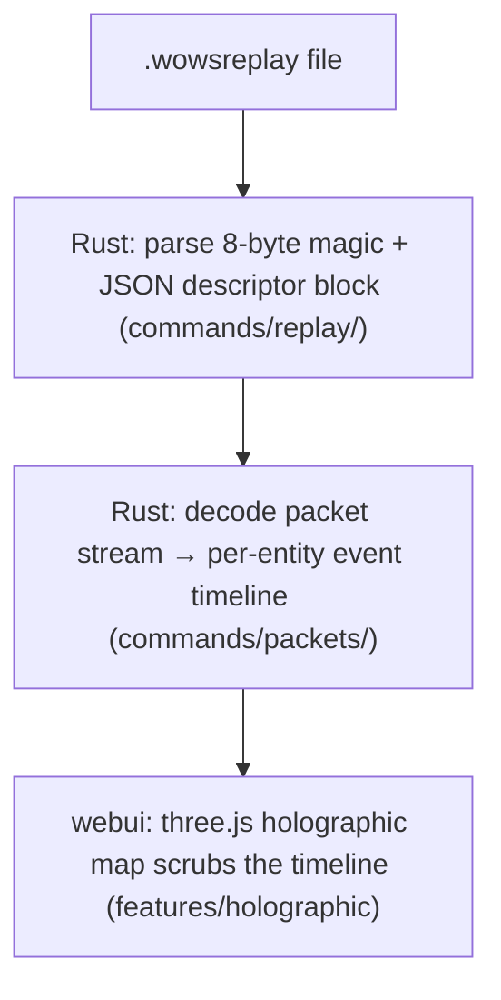
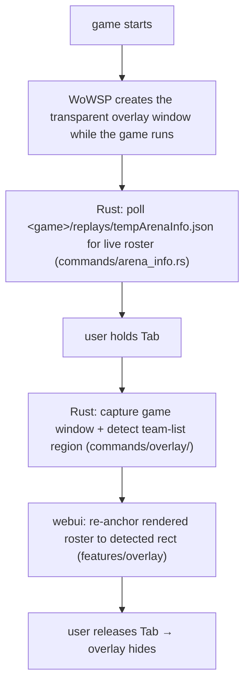

# Architecture

> **Audience**: Developers who need to understand how WoWSP works internally.

## Two operating modes

WoWSP is a single Tauri 2 desktop app with one frontend (Vue 3 + three.js) that
runs in two modes, sharing most of the Rust backend.

### Mode 1 — Standalone review

Open a `.wowsreplay` and watch the whole match rendered on a holographic 3D map,
without launching the game.



Map and ship geometry come from GLB produced by `scripts/model_convert/`
(`convert_map.py`, `convert_ship.py`), which pull the source assets straight
from the detected game install (`just convert-map --name ...` /
`just convert-ship --name ...`) — no app change needed for new maps or ships.

### Mode 2 — In-game overlay

WoWSP runs alongside the game: while the game runs and the in-game overlay
setting is on, a transparent always-on-top window overlays both teams'
rosters, visible only while `Tab` is held. The first-party probe mod installed
into `res_mods/` bridges live battle data to it (see
`designs/ingame-stats-plugin.md`).



## Game-install detection

`commands/game_detect.rs` scans the Windows Uninstall registry for Wargaming /
Lesta / 360 publishers (mirroring ApeRadar's `ConfigWindow.AutoDetectGamePath`),
then additionally walks Steam library folders for `appmanifest_552990.acf`
(Steam appid 552990 = World of Warships) — the case ApeRadar misses — and
reads Lesta Game Center's own game index under `%ProgramData%\Lesta\GameCenter`
(preferences.xml `<working_dir>` entries + `apps\<game-id>\<hash>` path
files). The Lesta (Мир кораблей) client renamed its root stub to
`Korabli.exe`, so install-folder validation accepts either stub name and the
running-process watcher tracks `Korabli(.64).exe` as well. A manual path can
always be pinned.

## Replay file format

```text
4 bytes  magic       = {0x12, 0x32, 0x34, 0x11}
4 bytes  json_len    = little-endian u32
N bytes  json_block  = match descriptor (roster, map, match type)
4 bytes  meta_count  = u32, number of metadata blocks
...      metadata    = extra metadata blocks
...      packets     = encrypted/zlib packet stream
```

The Lesta (Мир кораблей) client renamed the container to `.korablireplay` and
switched to a different binary framing — those files are listed and imported
but header/packet parsing reports an explicit unsupported-format error until
the new layout is reverse-engineered. `tempArenaInfo.json`, the live-battle
arena descriptor, keeps its WG name and format.

`commands/replay/` implements the magic check + JSON block extraction; the
packet-stream decoder lives in `commands/packets/` (frames → payloads →
per-entity events, with per-version method tables) and feeds the event
timeline the holographic map scrubs.

## Tech stack

| Layer | Tech |
|---|---|
| Frontend | Vue 3 (TSX) + UnoCSS + co-located SCSS + Pinia + vue-i18n + three.js |
| Desktop shell | Tauri 2 (Rust) |
| Backend IPC | `#[tauri::command]` handlers in `packages/app/tauri/src/commands/` |
| Mock backend | FastAPI (`scripts/mock/`) for browser/e2e development |
| Build | Cargo + pnpm workspace, `just` recipes, Python tooling |
| Docs | lagrange multilingual site |

## El lado del servidor

WoWSP no es solo la aplicación de escritorio: `wowsp.langyo.xyz` (el nodo oficial) y cualquier nodo autoalojado forman un pequeño lado del servidor con tres formas construidas sobre un único núcleo de políticas (`packages/pairing-relay/crates/relay-core`):

| Forma | Paquete | Capacidades |
|---|---|---|
| Cloudflare Worker (oficial + autoalojamiento con el asistente) | `crates/relay-worker` (Rust→wasm) | todas |
| Binario nativo (VPS / LAN / Docker) | `crates/relay-server` (axum + SQLite) | todas |
| Adaptador edge de Vercel | `packages/relay-vercel` (TypeScript) | lookup + peers + blocks |

Sobre cada nodo cabalgan dos espacios de nombres:

- **Push de batalla** (`/gateway/*`, WebSockets) — el canal de estadísticas en vivo del teléfono; consulta `designs/gateway-push.md`.
- **La malla de caché** (`/api/lookup`, `/api/blocks`, `/api/peers`) — un proxy de caché para los orígenes públicos de estadísticas (vortex/WG/clanes, la lista de permitidos de 13 hosts), más un almacén de bloques direccionado por contenido (CIDv1, con un alias de puerta de enlace `/ipfs/<cid>`) y un registro de pares por difusión, de modo que la búsqueda en frío y lenta de un jugador se convierte en un acierto de caché para todos. Consulta `designs/cache-mesh.md` (y `designs/cache-mesh-trust.md` para la hoja de ruta de los resultados comunicados por el cliente).

En el cliente, cada petición de estadísticas recorre primero los servidores de caché configurados (ajustes ▸ conexión ▸ servidores de caché — el nodo oficial por defecto, más los nodos de la comunidad de la lista de pares de la malla) y luego cae a la cadena proxy → directo, sin cambios. Montar tu propio nodo es un camino de primera clase: `guides/self-host-gateway.md`.

## Provenance

The replay-parsing, game-detection, and `tempArenaInfo.json` polling principles
are adapted from [ApeRadar (海猴雷达)](https://github.com/zylalx1/ApeRadar). The
frontend shell, build infrastructure, and licensing model are adapted from
[shittim-chest](https://github.com/celestia-island/shittim-chest).
