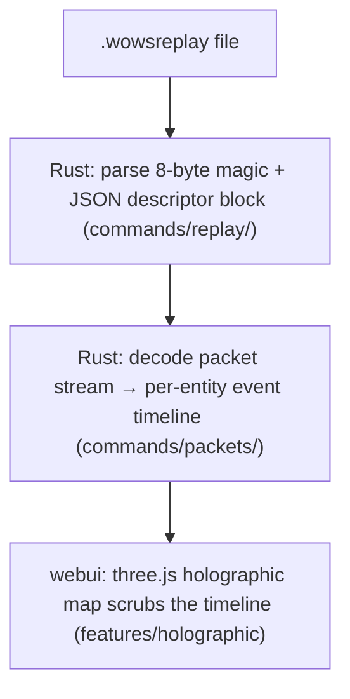
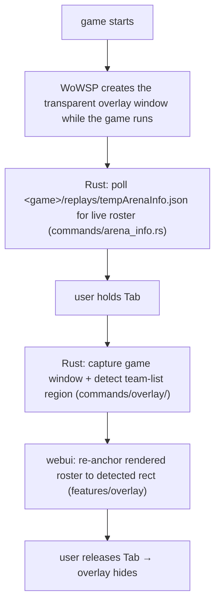

# Architecture

> **Audience**: Developers who need to understand how WoWSP works internally.

## Two operating modes

WoWSP is a single Tauri 2 desktop app with one frontend (Vue 3 + three.js) that
runs in two modes, sharing most of the Rust backend.

### Mode 1 — Standalone review

Open a `.wowsreplay` and watch the whole match rendered on a holographic 3D map,
without launching the game.



Map and ship geometry come from GLB produced by `scripts/model_convert/`
(`convert_map.py`, `convert_ship.py`), which pull the source assets straight
from the detected game install (`just convert-map --name ...` /
`just convert-ship --name ...`) — no app change needed for new maps or ships.

### Mode 2 — In-game overlay

WoWSP runs alongside the game: while the game runs and the in-game overlay
setting is on, a transparent always-on-top window overlays both teams'
rosters, visible only while `Tab` is held. The first-party probe mod installed
into `res_mods/` bridges live battle data to it (see
`designs/ingame-stats-plugin.md`).



## Game-install detection

`commands/game_detect.rs` scans the Windows Uninstall registry for Wargaming /
Lesta / 360 publishers (mirroring ApeRadar's `ConfigWindow.AutoDetectGamePath`),
then additionally walks Steam library folders for `appmanifest_552990.acf`
(Steam appid 552990 = World of Warships) — the case ApeRadar misses — and
reads Lesta Game Center's own game index under `%ProgramData%\Lesta\GameCenter`
(preferences.xml `<working_dir>` entries + `apps\<game-id>\<hash>` path
files). The Lesta (Мир кораблей) client renamed its root stub to
`Korabli.exe`, so install-folder validation accepts either stub name and the
running-process watcher tracks `Korabli(.64).exe` as well. A manual path can
always be pinned.

## Replay file format

```text
4 bytes  magic       = {0x12, 0x32, 0x34, 0x11}
4 bytes  json_len    = little-endian u32
N bytes  json_block  = match descriptor (roster, map, match type)
4 bytes  meta_count  = u32, number of metadata blocks
...      metadata    = extra metadata blocks
...      packets     = encrypted/zlib packet stream
```

The Lesta (Мир кораблей) client renamed the container to `.korablireplay` and
switched to a different binary framing — those files are listed and imported
but header/packet parsing reports an explicit unsupported-format error until
the new layout is reverse-engineered. `tempArenaInfo.json`, the live-battle
arena descriptor, keeps its WG name and format.

`commands/replay/` implements the magic check + JSON block extraction; the
packet-stream decoder lives in `commands/packets/` (frames → payloads →
per-entity events, with per-version method tables) and feeds the event
timeline the holographic map scrubs.

## Tech stack

| Layer | Tech |
|---|---|
| Frontend | Vue 3 (TSX) + UnoCSS + co-located SCSS + Pinia + vue-i18n + three.js |
| Desktop shell | Tauri 2 (Rust) |
| Backend IPC | `#[tauri::command]` handlers in `packages/app/tauri/src/commands/` |
| Mock backend | FastAPI (`scripts/mock/`) for browser/e2e development |
| Build | Cargo + pnpm workspace, `just` recipes, Python tooling |
| Docs | lagrange multilingual site |

## 서버 측

WoWSP는 데스크톱 앱만이 아니다. `wowsp.langyo.xyz`(공식 노드)와 어떤 자체 호스팅 노드든 함께 모여, 하나의 정책 코어(`packages/pairing-relay/crates/relay-core`)에서 만들어진 세 가지 형태의 작은 서버 측을 이룬다:

| 형태 | 패키지 | 기능 |
|---|---|---|
| Cloudflare Worker(공식 + 마법사 자체 호스팅) | `crates/relay-worker`(Rust→wasm) | 전체 |
| 네이티브 바이너리(VPS / LAN / Docker) | `crates/relay-server`(axum + SQLite) | 전체 |
| Vercel 엣지 어댑터 | `packages/relay-vercel`(TypeScript) | lookup + peers + blocks |

모든 노드에는 두 개의 네임스페이스가 함께 돌아간다:

- **전투 푸시**(`/gateway/*`, WebSocket) — 휴대폰의 라이브 전적 채널. `designs/gateway-push.md` 참고.
- **캐시 메시**(`/api/lookup`, `/api/blocks`, `/api/peers`) — 공개 전적 업스트림(vortex/WG/클랜, 13개 호스트 허용 목록)을 위한 캐싱 프록시에, 콘텐츠 주소 방식 블록 저장소(CIDv1, `/ipfs/<cid>` 게이트웨이 별칭 포함)와 브로드캐스트 방식 peer 레지스트리를 더한 것이라, 한 플레이어의 느린 콜드 조회가 모두의 캐시 히트가 된다. `designs/cache-mesh.md` 참고(클라이언트가 보고하는 결과에 대한 로드맵은 `designs/cache-mesh-trust.md`).

클라이언트에서는 모든 전적 요청이 설정된 캐시 서버(설정 ▸ 연결 ▸ 캐시 서버 — 기본은 공식 노드 + 메시의 peer 목록에 있는 커뮤니티 노드)를 먼저 거치고, 그다음에 변함없는 프록시 → 직접 연결 체인으로 넘어간다. 자체 노드 운영도 일급 경로다: `guides/self-host-gateway.md`.

## Provenance

The replay-parsing, game-detection, and `tempArenaInfo.json` polling principles
are adapted from [ApeRadar (海猴雷达)](https://github.com/zylalx1/ApeRadar). The
frontend shell, build infrastructure, and licensing model are adapted from
[shittim-chest](https://github.com/celestia-island/shittim-chest).
